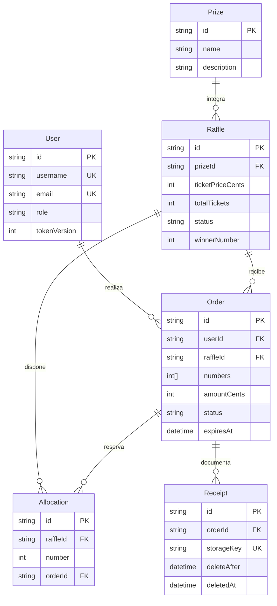
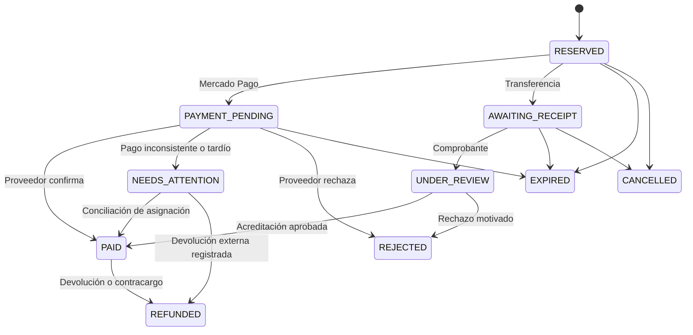
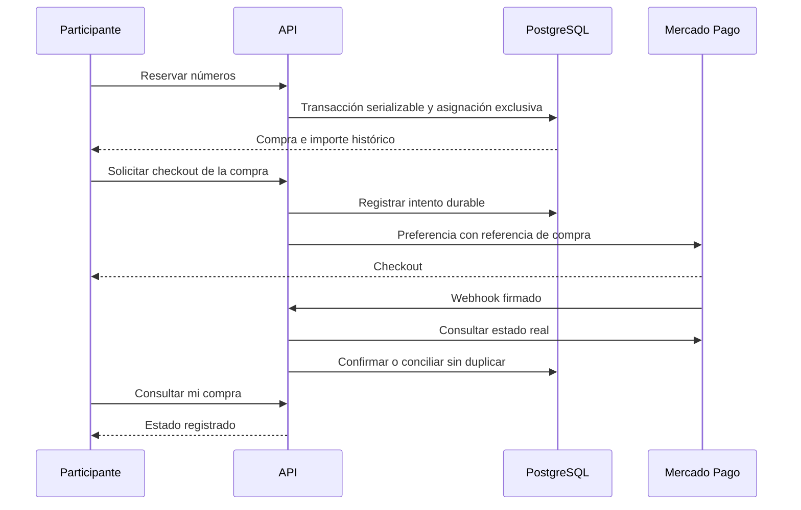

# Dominio, requisitos y reglas

`AuditLog` mantiene actor como identificador histórico y no como relación eliminable. Las relaciones de negocio usan `onDelete: Restrict` para impedir borrar el historial. Los números de una compra se preservan también en su arreglo histórico; las asignaciones se pueden liberar sin borrar la compra. Índice único `(raffleId, number)` en Allocation. Credenciales y referencias sensibles no forman parte de disponibilidad pública.

| ID | Requisito / regla |
|---|---|
| RF01 | Catálogo público de rifas activas/finalizadas, sin borradores |
| RF02 | Registro/login, perfil y compras propias; permisos por rol |
| RF03 | CRUD de premios, rifas y acceso de usuarios por administrador |
| RF04 | Reserva de hasta 20 números, validación y total calculado en servidor |
| RF05 | Enlace de pago Mercado Pago y confirmación mediante proveedor |
| RF06 | Transferencia, carga privada y revisión de comprobante |
| RF07 | Historial de compras y auditoría de acciones sensibles |
| RF08 | Sorteo único entre números con pago confirmado y resultado público |
| RF09 | Limpieza automática de comprobantes y conservación de historial |
| RN01 | Sólo rifa ACTIVE admite reserva; rango 1..totalTickets |
| RN02 | Número exclusivo por rifa, incluso ante solicitudes simultáneas |
| RN03 | Reserva inicial 5 min; pago MP 30 min; transferencia 24 h para cargar comprobante |
| RN04 | Comprobante enviado mantiene números bajo revisión; aprobación requiere archivo vigente y todas las asignaciones |
| RN05 | `amountCents = unitPriceCents × cantidad`; cambiar precio de rifa no altera compras existentes |
| RN06 | Registro público crea USER; ADMIN sólo por seed controlado o administrador autenticado |
| RN07 | Ningún participante accede a comprobantes/compras de otro |
| RN08 | Archivo PDF/JPG/PNG hasta 5 MB, contenido básico coincidente con MIME |
| RN09 | Archivo vence a tres meses calendario desde la carga; se conserva metadato, hash y decisión |
| RN10 | Reintento de Webhook no duplica confirmación; rechazo de otro intento no deshace compra pagada |
| RN11 | Pago aprobado sin asignación vigente requiere conciliación; no desplaza al titular actual |
| RN12 | No borrar rifa con compras ni premio asociado a rifas; desactivar usuarios conserva historial |
| RN13 | No puede retirarse el propio acceso ni dejar al sistema sin administrador activo |
| RN14 | Sortear requiere rifa activa, fecha alcanzada si existe y compras pendientes resueltas |
| RN15 | Sorteo usa crypto.randomInt sobre números pagados y registra elegibles, ganador, fecha y actor; no se repite |

